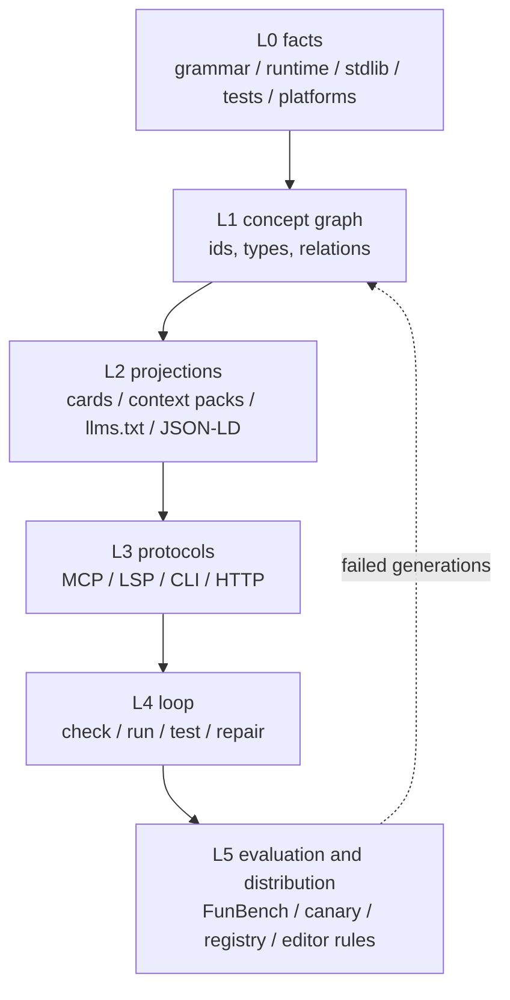

# Fun's AI ontology layer

> Goal: turn "can write Fun" from accidental knowledge in model weights into a
> searchable, executable, measurable, versioned external knowledge layer.
> The runnable seed is in [`ontology/`](../ontology/README.md). The longer
> Chinese design note is [`ai-ontology.zh.md`](ai-ontology.zh.md).

## 1. The problem is the shape of the knowledge

A model writes a language well when four things line up: pretraining exposure,
relevant context, grounded tools, and a fast verification loop. Fun has a small
pretraining footprint, and its Pascal-family syntax invites negative transfer
from JavaScript, Python and C. Models reliably write `console.log`, `print`,
`==`, `let`, `{}`, assume newlines end statements, assume `'\n'` is a newline,
and assume a missing key is safe in arithmetic.

The manual is written for humans. An agent needs small, addressable,
composable, checkable units. The ontology layer is that shape.

## 2. Definition

An executable ontology is:

```text
stable ids + typed entities + explicit relations + runnable evidence
+ multi-view projections + a tool protocol + version constraints
```

Four tests:

- **Addressable**: every item has a stable id (`syntax.json`,
  `pit.optional-chain`) that docs, tools and evaluations all cite.
- **Composable**: edges (`requires`, `seeAlso`, `fixedBy`) let a tool select a
  context pack instead of pasting the manual.
- **Verifiable**: every claim carries a runnable example with exact output. CI
  runs them and fails on drift.
- **Projectable**: one graph projects into a 400-token card, an 8 KB language
  card, a 17 KB full text, and a JSON-LD graph.

## 3. Layers



**L0 facts** already exist: the EBNF and yacc grammar, the core sources, the
standard library, the regression suite, the docs and changelog, the platform
capability matrix. The rule is: the ontology does not duplicate facts, it
cites them.

**L1 graph** currently has 71 concepts: constructs, semantics, built-ins,
modules, idioms, pitfalls, tools, platforms and tasks. Types drive projection
and ranking; levels drive token budgets; edges drive expansion.

**L2 projections** are generated, never hand-edited:

| View | Size | Use |
| ---- | ---- | --- |
| `cards/level0.md` | ~8 KB | system prompt, `AGENTS.md`, editor rules |
| `cards/level1.md` | ~17 KB | common tasks with one example each |
| `cards/level2.md` | ~20 KB | full reference |
| `llms.txt` | ~10 KB | crawler discovery |
| `llms-full.txt` | ~25 KB | full text |
| `fun_context(task, budget)` | 400 to 32000 chars | dynamic task pack |
| `fun.ontology.jsonld` | ~42 KB | graph stores, semantic retrieval |

**L3 protocols** start with MCP over stdio:

| Tool | Input | Output |
| ---- | ----- | ------ |
| `ontology_search` | `query`, `limit` | ranked summaries |
| `ontology_get` | `id` | full concept and examples |
| `fun_context` | `task`, `budget`, `detail` | budgeted pack |
| `fun_run` | `code`, `stdin`, `timeoutMs` | exit code, stdout, stderr |
| `fun_check` | `code` | parse result |

Next: an LSP, `fun explain`, `fun context`, and an HTTP MCP endpoint for hosted
agents.

**L4 loop** is context, generate, check, run, repair. Determinism is the point:
same input, same graph, same runtime, same output.

**L5 evaluation** has three tiers: example-level (all 70 examples), task-level
(FunBench with hidden tests), and drift-level (re-run on every release and
block on regression). Metrics include first-shot pass rate, repair turns,
tokens per task, pitfall hit rate and cross-language transfer accuracy.

## 4. Record shape

```fd
-
  id syntax.json
  type construct
  name JSON
  summary The built-in `value.@toJson()` emits JSON; ...
  level 0
  tags
    - core
    - data
  card `s.getJson(json: true); v.@toJson(json: true);`
  intent
    - json parse
    - 解析JSON
  from
    js `JSON.parse(s); JSON.stringify(v)`
    py `json.loads(s); json.dumps(v)`
  relations
    seeAlso
      - syntax.fd
      - module.lib-json
  examples
    -
      code `var m = '{"a": 1}'.getJson(json: true);
?. m.a;
`
      expect `1
`
```

`from` is the anti-negative-transfer field: it gives the model an explicit
mapping from what it already knows. `examples` is the anti-hallucination
field: it is executable and compared byte for byte. `relations` is the
anti-rot field: a missing target fails the build.

## 5. Context compilation

`fun_context(task, budget)` tokenizes the task, scores concepts on id, name,
summary, tags, intents and `from`, selects the top N, renders at card, syntax
or example detail, and fills remaining budget with high-risk pitfalls.

The seed uses lexical scoring. The next steps are embedding recall followed by
graph-aware reranking, `requires` closure, learned task-to-concept weights, and
caching.

## 6. What this buys an AI

- It does not have to guess the print form, the equality operator, the block
  terminators or the return convention.
- It gets the exact form of the standard library entry it needs, not a
  plausible-looking one.
- It gets a check and a run tool, so a wrong guess is caught in one turn.
- It gets version and platform constraints, so it stops recommending APIs that
  do not exist in the target build.
- It gets a benchmark, so improvements can be measured instead of argued.

## 7. Roadmap

- **M0 (this change)**: 71 concepts, 70 executed examples, validator, cards,
  `llms.txt`, JSON-LD, MCP server, a 119-module stdlib index, and a 5-task
  FunBench seed.
- **M1 (in progress)**: the stdlib index and `stdlib_search` exist; next are
  richer signatures, module examples, doctests and the `fun check` /
  `fun explain` CLI.
- **M2**: expand FunBench to 30 to 50 hidden-test tasks, add a canary and a
  public leaderboard.
- **M3**: mine failed generations (opt-in) into pitfall candidates, community
  contribution flow.
- **M4**: publish on funlang.org, editor rules, LSP, MCP registry.

## 8. Risks

| Risk | Mitigation |
| ---- | ---------- |
| Docs drift | run every example, fail CI |
| Graph bloat | levels, budgets, relation-based selection |
| Version skew | `funVersion`, `status`, canary |
| Benchmark overfit | hidden tests, rotating tasks, multiple domains |
| Unsafe execution | `fun-safe`, containers, timeouts, no network by default |
| Contribution friction | template, one-command check, worked examples |

## 9. The test of a good concept

Delete it. Would an AI become more likely to write Fun wrong? If not, it is
documentation, not ontology.
