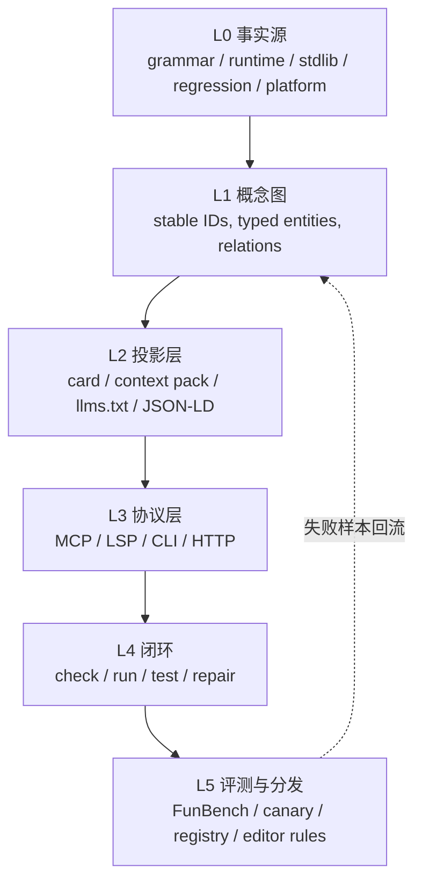
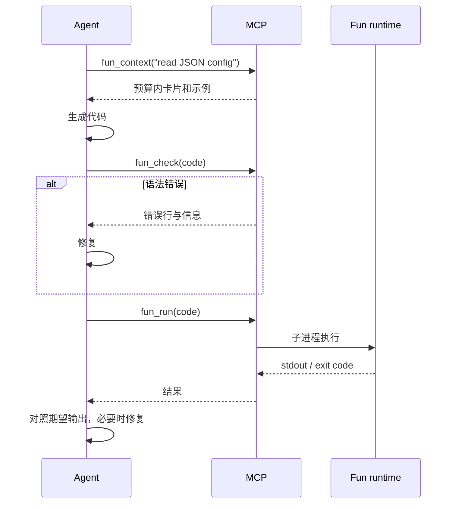
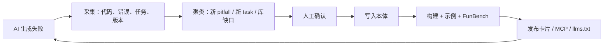

# Fun 语言的本体层：让 AI 像熟悉母语一样写 Fun

> 目标：把“会写 Fun”从模型参数里的偶然知识，变成一套可检索、可执行、可评测、可版本化的外部知识层。
> 本文是设计说明和落地路线图。可运行的种子实现见 [`ontology/`](../ontology/README.md)。

## 1. 问题不在文档数量，而在知识形态

大模型能熟练写一门语言，通常同时依赖四个条件：

1. **先验**：预训练语料里见过大量该语言的代码；
2. **上下文**：当前窗口里有准确的语法、库和示例；
3. **工具**：能查符号、查签名、查错误码，而不是靠猜；
4. **反馈**：写完能立刻编译、运行、测试，错误能快速定位。

Fun 的现状是：先验很弱，语法又属于“看起来像主流语言，细节全不一样”的类型。模型很容易把 JavaScript、Python、C 的习惯直接搬过来，产生稳定的负迁移：

- 写 `console.log`、`print`、`==`、`let`、`{}`；
- 以为换行能结束语句；
- 以为 `'\n'` 是换行；
- 以为 `filter(xs, f)` 能像 `map` 一样走管道；
- 以为 `result` 每次调用都会清零；
- 以为缺失键参与算术会得到 nil。

这些不是“文档没写”，而是**文档是给人读的，AI 需要的是最小、可定位、可组合、可验证的知识单元**。本体层要解决的就是这个形态问题。

## 2. 什么是“本体层”

这里说的本体不是 RDF 玩具，也不是另写一套百科。它是一张**可执行本体**：

```text
稳定 ID + 类型化实体 + 显式关系 + 可运行证据 + 多视图投影 + 工具协议 + 版本约束
```

四个判定标准：

- **可定位**：每个知识点有稳定 ID，例如 `syntax.json`、`pitfall.optional-chain`。模型、工具、文档、评测都引用同一个 ID。
- **可组合**：知识之间有边（`requires`、`seeAlso`、`fixedBy`）。给定任务，可以沿边做上下文选择，而不是把整本手册塞进窗口。
- **可验证**：每条结论至少挂一个可运行示例，示例有精确期望输出。CI 执行全部示例，失败即阻断。
- **可投影**：同一张图能按 token 预算投影成 400 字卡片、8 KB 语言卡、16 KB 全量文本、JSON-LD 图。

本体层不是“再写一份文档”，而是把语法、语义、标准库、测试、平台差异和踩坑记录**收敛到同一个数据源**，再用不同视图服务不同消费者。

## 3. 分层架构



### L0 事实源

现有仓库已经具备高质量事实源，只是没有面向 AI 组织：

- `src/parse/bnf/fun.ebnf` 与 `yacc.y`：语法；
- `src/core/*.pas`：求值、作用域、对象模型；
- `fun/lib/*.fun`：约 90 个标准库模块；
- `fun/test/*.fun`：回归基线，尤其是 `lang-semantics.fun` 这类语义钉子；
- `docs/*.md`、`man.htm`、`CHANGELOG.md`：人类文档与版本变化；
- `capabilities.json`、平台构建脚本：能力矩阵。

L0 的关键纪律：**本体不复制事实，只引用事实**。能生成的就生成，能测试的就测试。

### L1 概念图

当前种子有 71 个概念，覆盖：

| 类型 | 例子 | 作用 |
| ---- | ---- | ---- |
| `construct` | `syntax.json`, `syntax.pipe` | 语法形态与最小卡片 |
| `semantic` | `sem.result`, `sem.case-insensitive` | 容易误解的求值规则 |
| `builtin` | `builtin.tojson` | 引擎方法 |
| `module` | `module.lib-set`, `module.fs` | 库入口 |
| `idiom` | `idiom.default`, `idiom.pipeline` | 任务级写法 |
| `pitfall` | `pit.optional-chain`, `pit.backslash-escape` | 反例与修正 |
| `tool` | `tool.funcmd`, `tool.fun-safe` | 工具链 |
| `platform` | `platform.matrix` | 平台约束 |
| `task` | `task.json-transform` | 端到端配方 |

关系不是装饰。典型查询：

- 写 JSON：`syntax.json` -> `requires` -> `module.lib-json` -> `seeAlso` -> `syntax.fd`；
- 遇到可选链错误：`pit.optional-chain` -> `seeAlso` -> `syntax.member`；
- 写计数器：`sem.nil-arithmetic` -> `seeAlso` -> `pit.missing-key-accumulate` -> `seeAlso` -> `sem.missing-is-nil`。

### L2 投影层

同一张图按预算投影：

| 视图 | 规模 | 用途 |
| ---- | ---- | ---- |
| `cards/level0.md` | 约 8 KB | 系统提示、`AGENTS.md`、编辑器规则 |
| `cards/level1.md` | 约 17 KB | 常见任务，带一个示例 |
| `cards/level2.md` | 约 20 KB | 全量参考 |
| `llms.txt` | 约 10 KB | 爬虫发现入口 |
| `llms-full.txt` | 约 25 KB | 完整文本 |
| `fun_context(task, budget)` | 400 到 32000 字符 | 按任务动态拼装 |
| `fun.ontology.jsonld` | 约 42 KB | 图数据库、语义检索 |

投影层要解决两个矛盾：

- **覆盖 vs 预算**：推理时窗口有限，不能塞全量。用 `level`、`tags`、`intent`、关系边做选择。
- **稳定 vs 变化**：卡片要稳定，细节可以变。卡片只放“不可再压缩”的形态，长尾放 level 2。

### L3 协议层

首要是 MCP。任何支持 MCP 的编码智能体都能通过工具拿真实答案：

| 工具 | 输入 | 输出 |
| ---- | ---- | ---- |
| `ontology_search` | `query`, `limit` | 排名后的概念摘要 |
| `ontology_get` | `id` | 完整概念、示例、迁移锚点 |
| `fun_context` | `task`, `budget`, `detail` | 预算内上下文包 |
| `fun_run` | `code`, `stdin`, `timeoutMs` | 退出码、stdout、stderr |
| `fun_check` | `code` | 只解析，不执行顶层语句 |

进一步可以加：

- LSP：补全、跳转、诊断，编辑器里的模型直接受益；
- `fun explain <symbol>`、`fun doc <symbol>`、`fun context --task ...`；
- HTTP 版 MCP，给不能起本地进程的托管智能体。

### L4 闭环

生成不是终点。可靠工作流是：



闭环的关键是**确定性**：同一个输入，同一份本体，同一版运行时，输出一致。示例必须能重复执行。

### L5 评测与分发

没有评测，本体层会退化成“写得挺好看的文档”。需要三层评测：

1. **示例级**：每个概念的示例必须通过。当前 70 个示例全过。
2. **任务级**：FunBench，隐藏测试，跨难度，跨领域（数据、IO、HTTP、FFI、并发）。
3. **漂移级**：同一组任务在每次本体/运行时发布时重跑，分数下降即阻断。

指标不能只看“能不能跑”，要看 AI 的真实成本：

- 首次通过率（first-shot compile and run）；
- 修复轮数（turns to green）；
- 每任务 token 成本；
- 语义陷阱命中率（是否踩了 `pit.*`）；
- 跨语言迁移准确率（从 JS/Python/C 改写到 Fun）。

## 4. 数据模型

核心记录：

```fd
-
  id syntax.json
  type construct
  name JSON
  summary The built-in `value.@toJson()` emits JSON; ...
  level 0
  tags
    - core
    - data
  card `s.getJson(json: true); v.@toJson(json: true);`
  intent
    - json parse
    - 解析JSON
  from
    js `JSON.parse(s); JSON.stringify(v)`
    py `json.loads(s); json.dumps(v)`
  relations
    seeAlso
      - syntax.fd
      - module.lib-json
  examples
    -
      code `var m = '{"a": 1}'.getJson(json: true);
?. m.a;
`
      expect `1
`
```

字段设计要点：

- `id`：小写点分命名，稳定不变。ID 是协议，不是标题。
- `type`：决定投影位置和检索权重。
- `level`：0 必须会，1 常用，2 专家。预算选择的第一旋钮。
- `card`：一行可执行形态。卡片的目标是“抄了就能用”，不是解释。
- `summary`：一句话解释，允许长一点，但必须能独立读懂。
- `intent`：自然语言任务词，中英双语。检索用。
- `from`：跨语言锚点。这是对抗负迁移的核心字段。
- `relations`：边。缺失目标会让构建失败。
- `examples`：代码 + 精确输出 + 是否可运行 + 是否反例。

### 为什么 `from` 很重要

模型不是空白的。它带着 JavaScript、Python、C 的先验。与其假装没有，不如显式给出映射：

```text
console.log(x)     ->  ?. x;
print(x)           ->  ?. x;
JSON.parse(s)      ->  s.getJson(json: true)
JSON.stringify(v)  ->  v.@toJson(json: true)
x ?? default       ->  x or default
undefined + 1      ->  nil + 1 得到 1
```

有了 `from`，检索“怎么打印”时能直接命中 `syntax.print`，同时看到三种来源语言的锚点。模型不需要先学会“这是 Pascal 家族”，再推理。

### 为什么反例是头等公民

正面示例教“可以这样写”，反例教“不要这样写”。对 AI 来说，反例往往更有信息量，因为它精确指向负迁移。

反例的写法：

- 用 `pitfall` 类型；
- 卡片写正确形态；
- `summary` 明确说“为什么错”；
- 示例最好能跑，并给出实际输出或错误；
- 通过 `fixedBy` 或 `seeAlso` 连到正确概念。

### 语义钉子

Fun 里有一批“看起来会错，实际如此”的规则，必须显式记录：

- 标识符大小写不敏感；
- `=` 在表达式里是相等，`<>` 是不等，没有 `==`；
- `result` 不会每次调用自动清零；
- 缺失成员、缺失键、越界索引都与 `nil` 相等；
- `nil` 进入算术按 0 处理，字符串按空串处理；
- 缺失值也和 0 相等，判断“是否存在”要用 `@has`；
- 管道把值作为**最后一个**实参，所以 `map` 能组合，`filter` 不能直接组合；
- 没有反斜杠转义，换行用 `10.toChar()` 或多行反引号字符串；
- `x?.k?` 只覆盖成员访问，不覆盖后续调用。

这些规则每一条都对应 `sem.*` 或 `pit.*`，并且有可执行示例。它们的价值在于**防止模型用其他语言的直觉填空**。

## 5. 检索与上下文编译

`fun_context(task, budget)` 的朴素版本：

1. 把任务拆词；
2. 对每个概念计算分数：ID、名称、摘要、标签、`intent`、`from` 的命中；
3. 按分数选 top N；
4. 按预算渲染：卡片、语法、示例三种详细度；
5. 预算足够时，补充高风险 `pitfall`。

```text
score = 12 * id命中 + 6 * summary命中 + 2 * 每个词命中
        + 2 * level0 + 1 * pitfall
```

这不是最终答案，但足够跑通闭环。下一步可以：

- 用 embedding 做语义召回，用本体边做重排；
- 用 `requires` / `partOf` 做依赖闭包，确保选中的概念不会缺前置；
- 用学习到的“任务到概念”分布替代手写权重；
- 缓存常用任务包，降低推理延迟。

## 6. 版本、平台与能力

本体必须带版本，否则模型无法判断知识是否过期。

- `meta.version`：本体版本；
- `meta.funVersion`：对应 Fun 版本；
- `since`：概念引入版本；
- `status`：`stable` / `experimental` / `deprecated`；
- `platform.matrix`：Windows、Linux、macOS、LoongArch64、riscv64；
- `capabilities.json`：某次构建缺什么能力。

发布策略：

- 运行时补丁版本升级时，重跑示例和 FunBench；
- 本体单独发版，允许比运行时快；
- 废弃概念保留 ID，标记 `deprecated`，不物理删除；
- `llms-full.txt` 带版本头和生成时间。

## 7. 反馈飞轮

本体不能靠人工一次性写完。需要持续回流：



隐私和边界：

- 默认不采集；用户显式开启才上传；
- 只收代码片段和错误类型，不收文件路径、密钥、业务数据；
- 公开数据集做脱敏和许可证检查；
- 内部失败样本可以只用于私有评测，不进入公开本体。

## 8. 落地路线图

### M0：种子（本次）

- 71 个概念，70 个可执行示例，0 失败；
- FD 源文件、JSON Schema、构建工具；
- `level0/1/2` 卡片、`llms.txt`、`llms-full.txt`、`AGENTS.md`、JSON-LD；
- MCP 服务：search / get / context / run / check，以及 `stdlib_search`；
- 标准库索引：119 个模块，含顶层函数、类和单例方法签名；
- FunBench 种子：5 个任务、10 个测试，参考解 10/10。

验收：`fun ontology/tools/build.fun --check` 全绿；MCP 客户端能完成一次“查 -> 生成 -> 检查 -> 运行”。

### M1：补全库与工具

- 标准库符号索引已在 M0 落地；继续补签名细节、模块级示例和 `module.*` 关联；
- 给常用模块加 3 到 5 个任务级示例；
- 加 `fun check`、`fun explain`、`fun context` CLI；
- MCP 增加 `stdlib_symbol`、`explain_error`；
- 文档示例纳入 doctest。

验收：常用 20 个模块都有入口卡片和至少一个可运行示例；MCP 能回答“这个函数签名是什么”。

### M2：评测

- 把 FunBench 从种子扩到 30 到 50 个任务，隐藏测试；
- 度量首次通过率、修复轮数、token 成本；
- 建立 canary：每次发布自动跑；
- 公开排行榜，鼓励模型和智能体适配。

验收：同一模型在“无本体”和“有本体”下分数有显著差异；本体版本回退能被 canary 捕获。

### M3：自动化与社区

- 失败样本聚类，自动生成 `pitfall` 候选；
- 从测试和 CHANGELOG 自动抽取语义变化；
- 社区贡献模板和 CI 校验；
- 与编辑器、CI、Issue 机器人集成。

验收：新增概念的平均成本降到“写一个示例 + 跑一次构建”；陈旧关系零容忍。

### M4：分发与生态

- funlang.org 发布 `llms.txt`、卡片、JSON-LD；
- 提供 VS Code / JetBrains / Neovim 的规则文件和 LSP；
- 进入 MCP 注册表；
- 提供不同模型、不同预算的“技能包”。

验收：外部智能体在只读 `llms.txt` 和 MCP 的情况下，能独立完成中等难度 Fun 任务。

## 9. 指标

| 指标 | 定义 | 目标 |
| ---- | ---- | ---- |
| 示例通过率 | `build.fun --check` 通过比例 | 100% |
| 关系完整率 | 关系目标存在的比例 | 100% |
| 首次通过率 | 一次生成即编译并运行通过 | 持续上升 |
| 修复轮数 | 到绿色所需交互轮数 | 持续下降 |
| token 成本 | 每任务上下文 + 生成 token | 持续下降 |
| 反例命中率 | 生成中触发 `pit.*` 的比例 | 持续下降 |
| 库覆盖率 | 有入口卡片的标准库模块比例 | 100% |

不要只追“分数”。如果首次通过率上升但 token 成本翻倍，实际可用性可能下降。评测要同时看效果和成本。

## 10. 风险与对策

| 风险 | 表现 | 对策 |
| ---- | ---- | ---- |
| 文档漂移 | 本体说一套，运行时做一套 | 示例执行 + CI 阻断 |
| 本体膨胀 | 卡片越来越长，窗口塞不下 | `level` + 预算投影 + 关系选择 |
| 版本错配 | 模型学过时 API | `funVersion` + `status` + canary |
| 评测过拟合 | 刷榜但真实任务差 | 隐藏测试 + 定期换题 + 多领域 |
| 安全 | `fun_run` 执行任意代码 | `fun-safe`、容器、超时、无网络默认 |
| 贡献门槛 | 没人愿意写 | 模板 + 一条命令校验 + 好示例 |

## 11. 如何贡献

1. 选一个缺口：任务、模块、错误、平台差异。
2. 在 `ontology/data/fun.ontology.fd` 加概念。
3. 至少写一个可运行示例，给出精确输出。
4. 跑 `fun ontology/tools/build.fun --check`。
5. 如果新增关系，确保目标存在。
6. 提交 PR，说明“这条知识解决了哪个真实失败”。

一条好知识的判断标准很简单：**把它从本体里删掉，AI 会不会更容易写错？** 如果不会，它可能只是文档，不是本体。

## 12. 一句话总结

Fun 的本体层不是“让 AI 读更多文档”，而是把语言知识变成**带 ID、带关系、带证据、带预算、带工具、带评测**的可执行结构。这样，模型不需要在参数里碰运气，而是可以在每一步查到、试到、验到。
